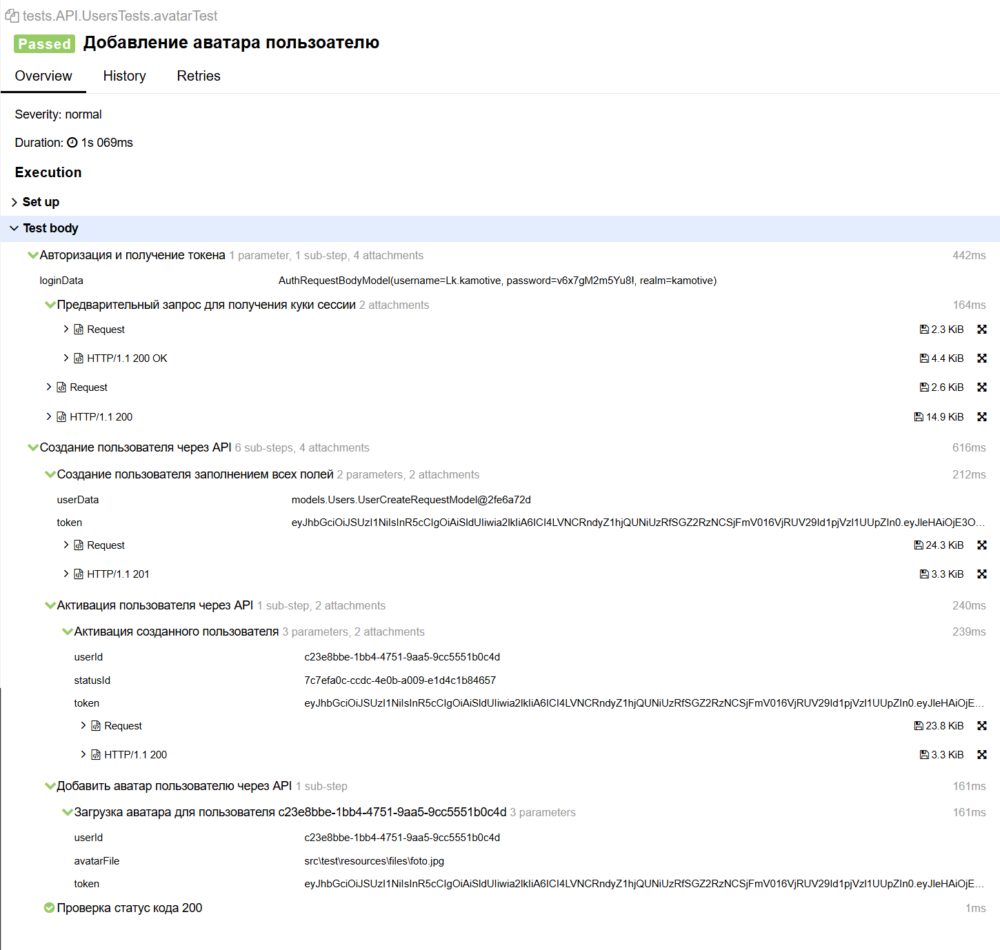
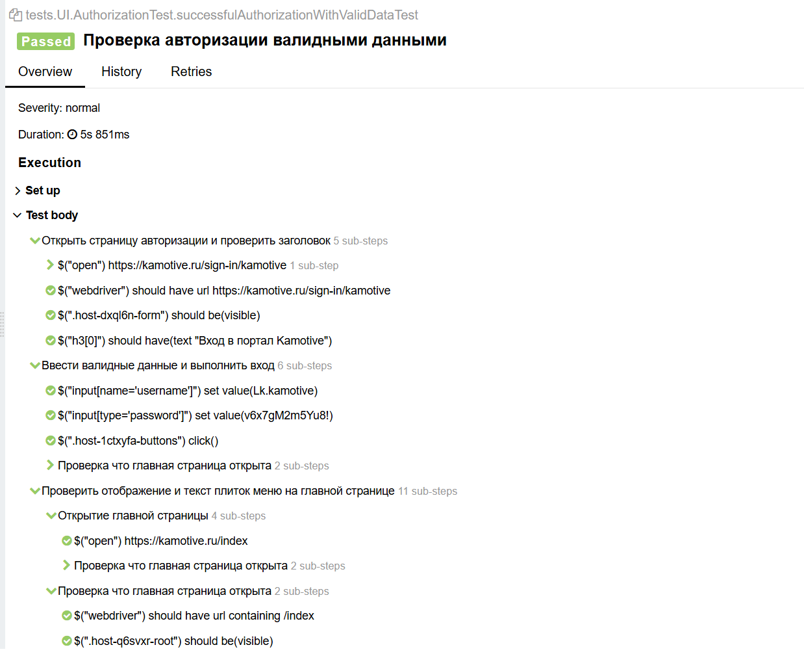
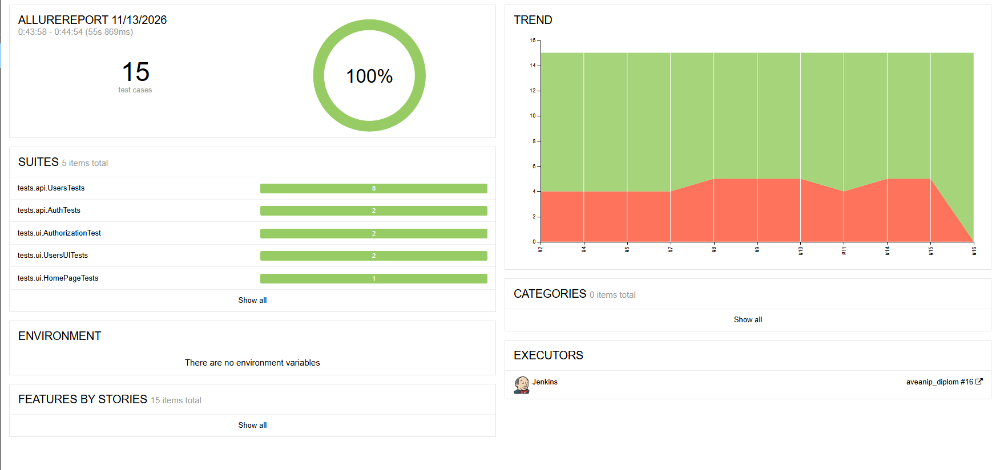
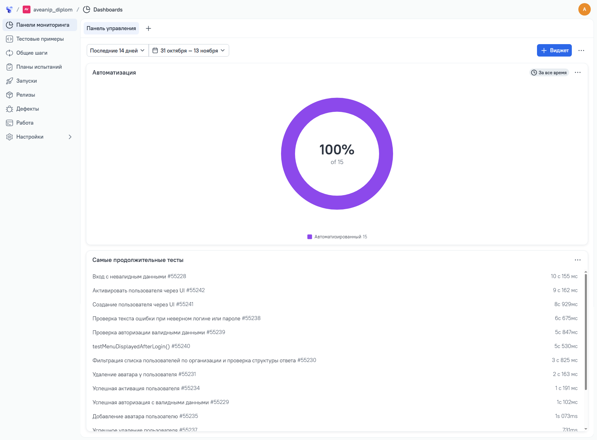

<div align="center">
  
  <h1>Проект по автоматизации тестирования API и UI платформы Kamotive</h1>
  <p>Автоматизированные API-тесты (Java + RestAssured) для цифровой платформы совместной разработки</p>
  <p>🔗 <a href="https://kamotive.ru" target="_blank">Перейти на сайт kamotive.ru</a></p>
  <p>🔗 <a href="https://kamotive.ru/sign-in/kamotive" target="_blank">Страница авторизации kamotive.ru</a></p>
</div>

---

## О проекте:

**Kamotive** — инновационная цифровая платформа для промышленности, предназначенная для совместной разработки высокотехнологичной продукции на базе единого безопасного пространства.

В рамках данного дипломного проекта был разработан фреймворк для **автоматизированного тестирования REST API** Авторизация и тесты для вкладки "Пользователи" (Users). Автоматизация покрывает ключевые бизнес-сценарии: Авторизация пользователя, Создание пользователя, активация пользователя, смена статуса.

## 🛠 Технологический стек

*   **Язык:** Java 17
*   **Тестовый фреймворк:** JUnit 5
*   **Библиотека для API:** RestAssured
*   **Отчетность:** Allure 
*   **Сборщик:** Gradle
*   **Утилиты:** Lombok (сокращение шаблонного кода), Jackson (работа с JSON), Java Faker (генерация тестовых данных)
---

# API — Управление пользователями (Kamotive)

| Метод                                                | Позитивный сценарий                                | Негативный сценарий                            |
|------------------------------------------------------|----------------------------------------------------|------------------------------------------------|
| `POST /core/api/v1/login`                            | Авторизация и получение токена → `200`             | Ошибка при не верно введенных данных → `404`   |
| `POST /core/api/v1/users`                            | Создание пользователя → `200`                      | -                                              |
| `GET  /core/api/v2/users`                            | Получение списка пользователей организации → `200` | -                                              |
| `POST /core/api/v1/users/{userId}/status/{statusId}` | Активация пользователя → `200`                     | -                                              |
| `POST /core/api/v1/users/{userId}/avatar`            | Загрузка автара пользователю → `200`               | -                                              |
| `DELETE /core/api/v1/users/{userId}/avatar`          | Удаление аватара пользователя → `200`              | -                                              |
| `DELETE //core/api/v1/users/{userId}`                | Удаление пользователя → `200`                      | Удаление не существующего пользователя → `404` |

# UI — Управление пользователями (Kamotive)

| Тестовые сценарий                                               | 
|-----------------------------------------------------------------|
| Проверка авторизации валидными данными                          |
| Проверка текста ошибки при неверном логине или пароле           |
| Проверка отображения меню на главной странице после авторизации |
| Создание пользователя                                           |
| Активация пользователя                                          |

## 📁 Структура проекта
```
📁 java_automation_kamotive
src/test/java/
├── allure/                 # Настройки и утилиты для Allure
├── api/                    # API-клиенты и запросы
├── helpers/                # Вспомогательные классы (Attach)
├── models/                 # Модели данных
├── pages/                  # Page Object Model (страницы UI)
├── specs/                  # Спецификации REST-assured
└── tests/                  # Тестовые классы
    ├── API/                # API тесты
    └── UI/                 # UI тесты
├── 📂 src/test/resources   # Ресурсы (схемы, файлы)
├── 📄 build.gradle         # Конфигурация Gradle
└── 📄 README.md            # Документация
```

Скриншот 1. Allure отчет API-теста "Добавление аватара пользователю API"


Скриншот 2. Allure отчет UI-теста "Проверка авторизации пользователя"


Скриншот 3. Пример Allure отчета


Скриншот 4. Пример Dashboard в TestOps


Скриншот 5. Пример ручного теста


## 📊 Отчёты и CI/CD
- **Jenkins Build**: [Ссылка на джобу в Jenkins](https://jenkins.qa.guru/job/aveanip_diplom/)
- **Allure Report**: [Последний отчёт Allure](https://jenkins.qa.guru/job/aveanip_diplom/18/)
- **Allure TestOps**: [Проект в Allure TestOps](https://allure.qa.guru/project/5436/test-cases)

**Запуск всех тестов:**
```bash
./gradlew test
